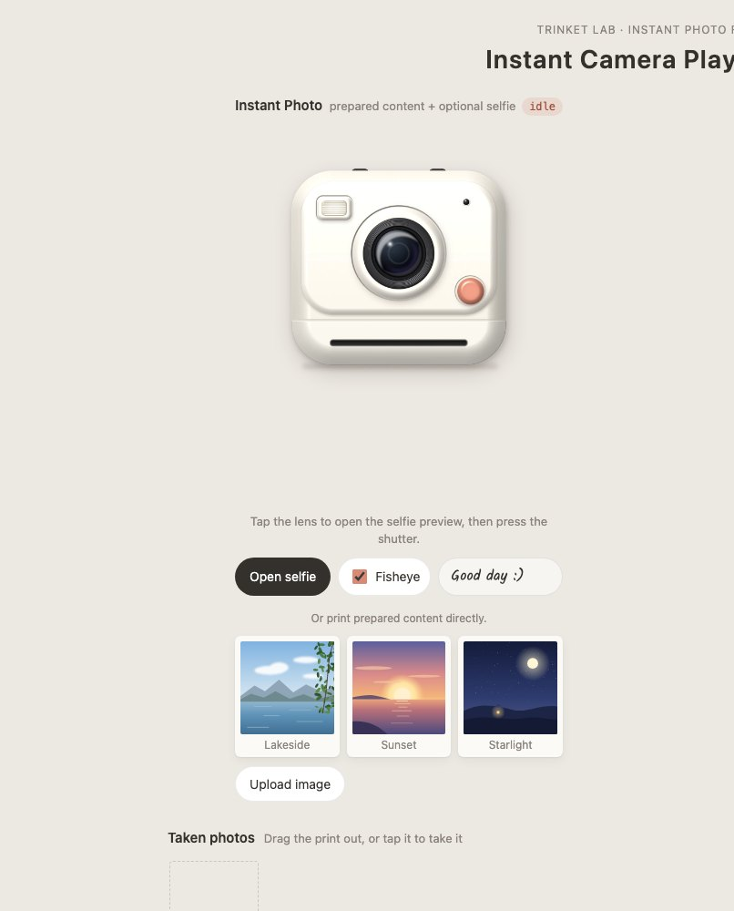
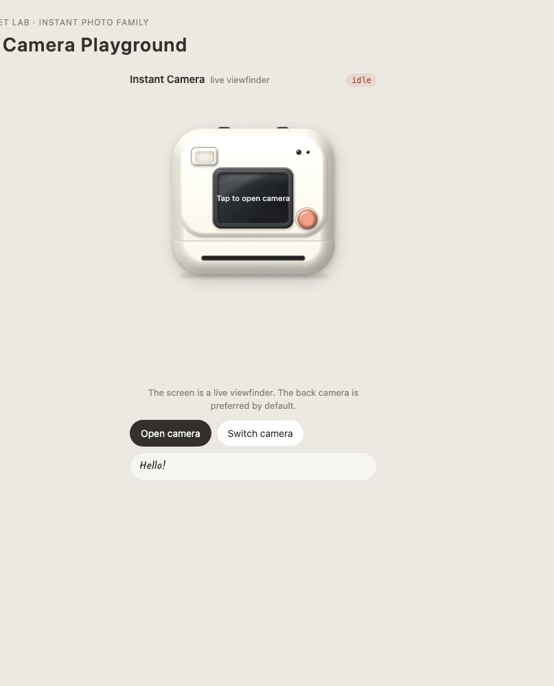
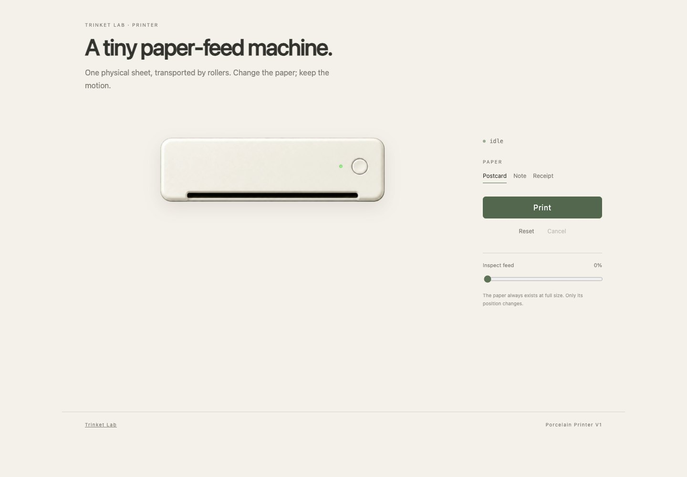
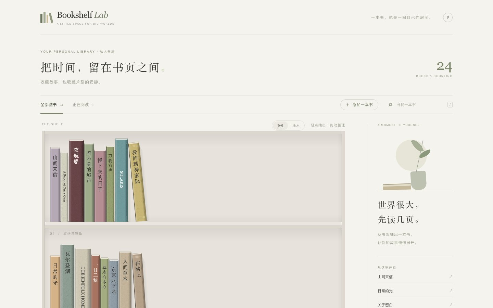

# Trinket Lab 🧸

**A collection of playful, reusable interactive objects for the web.**

[**Live demo →**](https://lilythking66-hub.github.io/Trinket-Lab/) · [Instant Photo](components/instant-photo/README.md) · [Instant Camera](components/instant-camera/README.md) · [Printer](components/printer/README.md) · [Bookshelf Lab](components/bookshelf-lab/README.md) · [Skin contract](docs/SKIN_CONTRACT.md)

Trinket Lab is a home for small digital objects that feel like things: cameras that eject photos, printers that feed paper, books that open and turn, gacha machines, gift boxes, radios, and other tactile interactions.

The goal is not to build one giant UI framework. Each trinket should stay small, understandable, skinnable, and reusable across different products.

## Live demos

- 📸 [**Instant Photo / Instant Camera →**](https://lilythking66-hub.github.io/Trinket-Lab/demos/instant-photo-family/)
- 🖨️ [**Printer →**](https://lilythking66-hub.github.io/Trinket-Lab/demos/printer/) — try the same feed engine with a postcard, note, and long receipt.
- 📚 [**Bookshelf Lab →**](https://lilythking66-hub.github.io/Trinket-Lab/demos/bookshelf/) — take out, reorder, open, read, and return books.

The public repository shows working components and their integration contracts. Internal visual boards, source mood sheets, and master-design breakdowns are intentionally kept out of the public repo.

## Principles

- **Object first.** A trinket should feel like a coherent interactive object, not a pile of disconnected effects.
- **Reusable by default.** Product-specific logic stays outside the core component.
- **Triggers are adapters.** QR scanning, buttons, external events, NFC, or other triggers should call a component; they should not be baked into it.
- **Skin without rewrites.** Visual skins and content recipes should be replaceable without changing the interaction engine.
- **Shared motion, separate products.** Related trinkets can share engines while keeping distinct public components.
- **Stay lightweight.** Add tooling only when the repository actually needs it.

## First family: Instant Photo

The first Trinket Lab family is built around a shared photo engine.

| Instant Photo | Instant Camera |
| --- | --- |
| [](https://lilythking66-hub.github.io/Trinket-Lab/demos/instant-photo-family/) | [](https://lilythking66-hub.github.io/Trinket-Lab/demos/instant-photo-family/) |

~~~text
Trigger / Content Source
        │
        ├───────────────┐
        ▼               ▼
  Instant Photo    Instant Camera
(prepared image /   (live viewfinder,
 optional selfie)    camera capture)
        │               │
        └───────┬───────┘
                ▼
          Photo Engine
 flash → eject → develop → take/save
~~~

### components/photo-engine

Shared interaction mechanics: photo card, ejection motion, developing effect, film rendering, and output lifecycle.

### components/instant-photo

Takes an image or prepared photo recipe and performs the instant-photo interaction. It is print-only by default: camera code is not loaded unless the optional `selfie` attribute is present.

### components/instant-camera

Adds a live viewfinder and camera capture, then feeds the captured frame into the same Photo Engine. Camera resources are created on demand and fully released when the element leaves the page.

### components/camera-kit

Shared `getUserMedia` lifecycle and optional WebGL fisheye rendering. The Photo Engine does not depend on it.

### triggers/qr

An optional QR adapter. It can resolve a code into a photo recipe and call Instant Photo, but **Instant Photo does not know or care whether QR exists**.

## Skins

The included runtime skins are sample implementations of the public asset contract. Product-specific art direction and internal master boards stay outside the public repository; the engine only depends on geometry, named layers, and states.

See [Instant Photo V1](docs/INSTANT_PHOTO_V1.md) for behavior and acceptance criteria, and [Skin Contract](docs/SKIN_CONTRACT.md) for the public asset boundary.

## Repository shape

~~~text
Trinket-Lab/
├── components/
│   ├── photo-engine/
│   ├── camera-kit/
│   ├── instant-photo/
│   ├── instant-camera/
│   ├── printer/
│   └── bookshelf-lab/
├── skins/
│   ├── neutral-camera-v1/
│   └── porcelain-printer-v1/
├── triggers/
│   └── qr/
├── demos/
│   ├── instant-photo-family/
│   └── printer/
└── docs/
    └── ARCHITECTURE.md
~~~

This is intentionally a lightweight foundation rather than a full monorepo setup. Build tooling can be introduced once multiple working trinkets genuinely need shared packaging/versioning.

## Future trinkets

Likely future residents include gacha machines, gift boxes, radios, photo booths, and other interactive props.

## Quick start

~~~sh
python3 -m http.server 8000
# open http://localhost:8000/demos/instant-photo-family/
~~~

~~~html
<script type="module" src="components/instant-photo/instant-photo.js"></script>
<instant-photo src="photo.jpg" caption="Good day :)"></instant-photo>
~~~

Add `selfie` only when you want camera access:

~~~html
<instant-photo selfie caption="Hi!"></instant-photo>
~~~

The Instant Photo family uses plain ES modules and Web Components with no build step and no dependencies. The same code runs on desktop and mobile (touch, mouse and keyboard).

## Localization

Core UI defaults are English and can be overridden by the host before the component is ready:

~~~js
const camera = document.querySelector("instant-camera");
camera.labels = { shutter: "Snap", take: "Keep photo", openCamera: "Start camera" };
camera.messages = {
  denied: { text: "Camera access is blocked" },
  actions: { retry: "Try again", pick: "Choose an image" },
};
~~~

Product-specific copy belongs in the host app, not in the shared engine.

## Status

**Instant Photo Family V1 is implemented.** Photo Engine, Camera Kit, Instant Photo, Instant Camera, the optional QR trigger, replaceable skins and the public demo are working. The acceptance suite covers desktop Chrome, iPhone-sized emulation, camera lifecycle cleanup, lazy selfie loading and QR removal (`demos/instant-photo-family/tests/acceptance.cjs`). See [Instant Photo V1](docs/INSTANT_PHOTO_V1.md#v1-status).

## Printer

[Printer](components/printer/README.md) is the second build-free Trinket family: a platform-neutral rigid-sheet feed core plus the `<trinket-printer>` Web Component and a replaceable porcelain skin. Paper content stays in the host through a slot, so postcards, notes, receipts or product-specific layouts all reuse the same feed mechanics.

[](https://lilythking66-hub.github.io/Trinket-Lab/demos/printer/)

### ▶ [Open the live Printer demo](https://lilythking66-hub.github.io/Trinket-Lab/demos/printer/)

The public demo deliberately feeds a postcard, a note, and a long receipt through the same machine so the reusable motion is visible without exposing internal design boards.

## Bookshelf Lab

[Bookshelf Lab](components/bookshelf-lab/README.md) is a reusable TypeScript, PixiJS 8 and GSAP bookshelf and reader engine. It includes responsive shelves, drag and keyboard reordering, foreground pull-out/open/return motion, a replaceable reader, local persistence, and optional EPUB/TXT/Markdown import.

[](https://lilythking66-hub.github.io/Trinket-Lab/demos/bookshelf/)

### ▶ [Open the live Bookshelf demo](https://lilythking66-hub.github.io/Trinket-Lab/demos/bookshelf/)

It remains a self-contained package under `components/bookshelf-lab/`; GitHub Pages builds its Vite demo during deployment rather than committing `dist/`.

```sh
cd components/bookshelf-lab
npm ci
npm run dev
# open http://localhost:5186/
```

Run `npm run build`, `npm test`, and `npm run test:e2e` for validation. See the package [architecture](components/bookshelf-lab/docs/ARCHITECTURE.md) and [acceptance notes](components/bookshelf-lab/docs/ACCEPTANCE.md).

## License

MIT. See [LICENSE](LICENSE).
