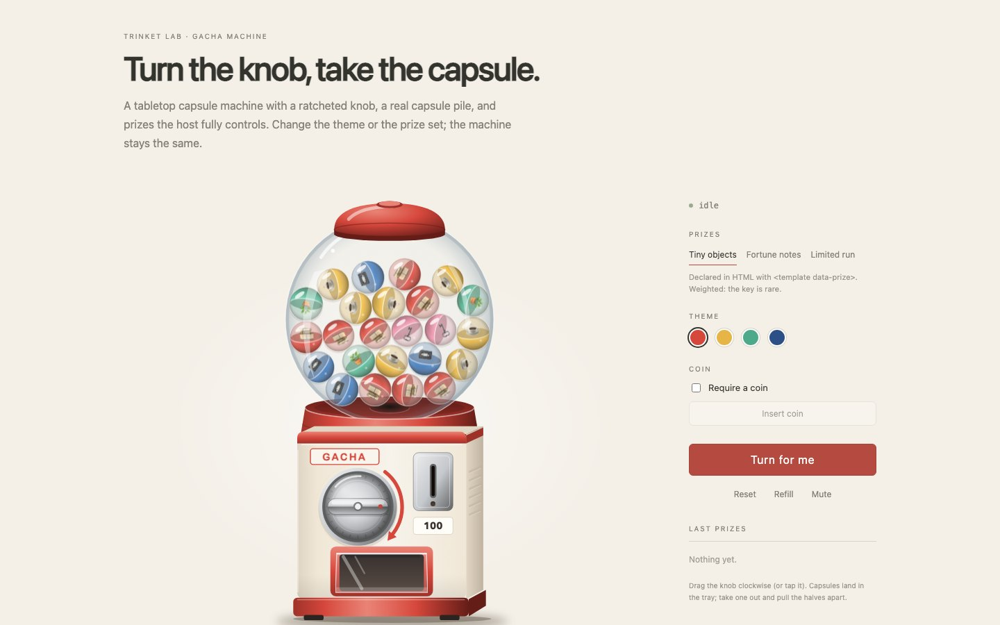
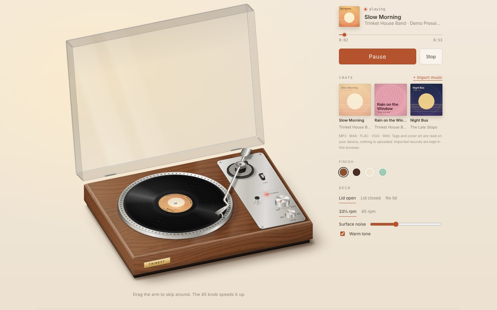
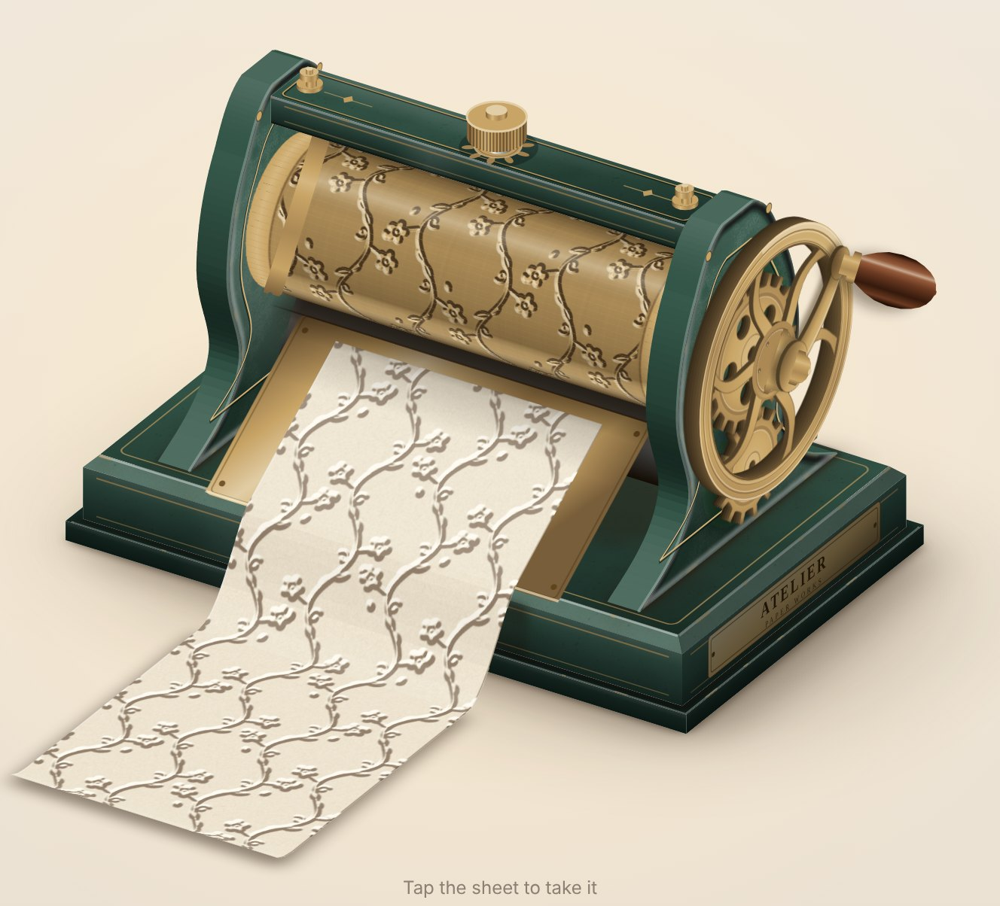

# Trinket Lab 🧸

**A collection of playful, reusable interactive objects for the web.**

[**Live demo →**](https://lilythking66-hub.github.io/Trinket-Lab/) · [Instant Photo](components/instant-photo/README.md) · [Instant Camera](components/instant-camera/README.md) · [Printer](components/printer/README.md) · [Bookshelf](components/bookshelf/README.md) · [Gacha](components/gacha/README.md) · [Turntable](components/turntable/README.md) · [Typewriter](components/typewriter/README.md) · [Projector](components/projector/README.md) · [Crank Press](components/crank-press/README.md) · [Skin contract](docs/SKIN_CONTRACT.md)

Trinket Lab is a home for small digital objects that feel like things: cameras that eject photos, printers that feed paper, books that open and turn, gacha machines, gift boxes, radios, and other tactile interactions.

The goal is not to build one giant UI framework. Each trinket should stay small, understandable, skinnable, and reusable across different products.

## Live demos

- 📸 [**Instant Photo / Instant Camera →**](https://lilythking66-hub.github.io/Trinket-Lab/demos/instant-photo-family/)
- 🖨️ [**Printer →**](https://lilythking66-hub.github.io/Trinket-Lab/demos/printer/) — try the same feed engine with a postcard, note, and long receipt.
- 📚 [**Bookshelf →**](https://lilythking66-hub.github.io/Trinket-Lab/demos/bookshelf/) — take out, reorder, open, read, and return books.
- 🎰 [**Gacha →**](https://lilythking66-hub.github.io/Trinket-Lab/demos/gacha/) — turn the knob, take the capsule, pull it apart; swap the prizes freely.
- 💿 [**Turntable →**](https://lilythking66-hub.github.io/Trinket-Lab/demos/turntable/) — import your own music, press it into a record, drop the needle.
- ⌨️ [**Typewriter →**](https://lilythking66-hub.github.io/Trinket-Lab/demos/typewriter/) — type on your own keyboard in any language; keys, typebars, carriage and bell answer.
- 🎞️ [**Projector →**](https://lilythking66-hub.github.io/Trinket-Lab/demos/projector/) — wind your photos onto a reel, run the filmstrip or project them in a dark room; MP4 too.
- 🌀 [**Crank Press →**](https://lilythking66-hub.github.io/Trinket-Lab/demos/crank-press/) — turn the wheel and let the brass roller press slips, tickets and notes.

The public repository shows working components and their integration contracts. Internal visual boards, source mood sheets, and master-design breakdowns are intentionally kept out of the public repo.

## Principles

- **Object first.** A trinket should feel like a coherent interactive object, not a pile of disconnected effects.
- **Reusable by default.** Product-specific logic stays outside the core component.
- **Triggers are adapters.** QR scanning, buttons, external events, NFC, or other triggers should call a component; they should not be baked into it.
- **Skin without rewrites.** Visual skins and content recipes should be replaceable without changing the interaction engine.
- **Shared motion, separate products.** Related trinkets can share engines while keeping distinct public components.
- **Stay lightweight.** Add tooling only when the repository actually needs it.

## First family: Instant Photo

The first Trinket Lab family is built around a shared photo engine.

| Instant Photo | Instant Camera |
| --- | --- |
| [](https://lilythking66-hub.github.io/Trinket-Lab/demos/instant-photo-family/) | [](https://lilythking66-hub.github.io/Trinket-Lab/demos/instant-photo-family/) |

~~~text
Trigger / Content Source
        │
        ├───────────────┐
        ▼               ▼
  Instant Photo    Instant Camera
(prepared image /   (live viewfinder,
 optional selfie)    camera capture)
        │               │
        └───────┬───────┘
                ▼
          Photo Engine
 flash → eject → develop → take/save
~~~

### components/photo-engine

Shared interaction mechanics: photo card, ejection motion, developing effect, film rendering, and output lifecycle.

### components/instant-photo

Takes an image or prepared photo recipe and performs the instant-photo interaction. It is print-only by default: camera code is not loaded unless the optional `selfie` attribute is present.

### components/instant-camera

Adds a live viewfinder and camera capture, then feeds the captured frame into the same Photo Engine. Camera resources are created on demand and fully released when the element leaves the page.

### components/camera-kit

Shared `getUserMedia` lifecycle and optional WebGL fisheye rendering. The Photo Engine does not depend on it.

### triggers/qr

An optional QR adapter. It can resolve a code into a photo recipe and call Instant Photo, but **Instant Photo does not know or care whether QR exists**.

## Skins

The included runtime skins are sample implementations of the public asset contract. Product-specific art direction and internal master boards stay outside the public repository; the engine only depends on geometry, named layers, and states.

See [Instant Photo V1](docs/INSTANT_PHOTO_V1.md) for behavior and acceptance criteria, and [Skin Contract](docs/SKIN_CONTRACT.md) for the public asset boundary.

## Repository shape

~~~text
Trinket-Lab/
├── components/
│   ├── photo-engine/
│   ├── camera-kit/
│   ├── instant-photo/
│   ├── instant-camera/
│   ├── printer/
│   ├── bookshelf/
│   ├── gacha/
│   ├── turntable/
│   ├── typewriter/
│   ├── projector/
│   └── crank-press/
├── skins/
│   ├── neutral-camera-v1/
│   └── porcelain-printer-v1/
├── triggers/
│   └── qr/
├── demos/
│   ├── instant-photo-family/
│   ├── printer/
│   ├── gacha/
│   ├── turntable/
│   ├── typewriter/
│   ├── projector/
│   └── crank-press/
└── docs/
    └── ARCHITECTURE.md
~~~

This is intentionally a lightweight foundation rather than a full monorepo setup. Build tooling can be introduced once multiple working trinkets genuinely need shared packaging/versioning.

## Future trinkets

Likely future residents include gift boxes, radios, photo booths, and other interactive props.

## Quick start

~~~sh
python3 -m http.server 8000
# open http://localhost:8000/demos/instant-photo-family/
~~~

~~~html
<script type="module" src="components/instant-photo/instant-photo.js"></script>
<instant-photo src="photo.jpg" caption="Good day :)"></instant-photo>
~~~

Add `selfie` only when you want camera access:

~~~html
<instant-photo selfie caption="Hi!"></instant-photo>
~~~

The Instant Photo family uses plain ES modules and Web Components with no build step and no dependencies. The same code runs on desktop and mobile (touch, mouse and keyboard).

## Localization

Core UI defaults are English and can be overridden by the host before the component is ready:

~~~js
const camera = document.querySelector("instant-camera");
camera.labels = { shutter: "Snap", take: "Keep photo", openCamera: "Start camera" };
camera.messages = {
  denied: { text: "Camera access is blocked" },
  actions: { retry: "Try again", pick: "Choose an image" },
};
~~~

Product-specific copy belongs in the host app, not in the shared engine.

## Status

**Instant Photo Family V1 is implemented.** Photo Engine, Camera Kit, Instant Photo, Instant Camera, the optional QR trigger, replaceable skins and the public demo are working. The acceptance suite covers desktop Chrome, iPhone-sized emulation, camera lifecycle cleanup, lazy selfie loading and QR removal (`demos/instant-photo-family/tests/acceptance.cjs`). See [Instant Photo V1](docs/INSTANT_PHOTO_V1.md#v1-status).

## Printer

[Printer](components/printer/README.md) is the second build-free Trinket family: a platform-neutral rigid-sheet feed core plus the `<trinket-printer>` Web Component and a replaceable porcelain skin. Paper content stays in the host through a slot, so postcards, notes, receipts or product-specific layouts all reuse the same feed mechanics.

[](https://lilythking66-hub.github.io/Trinket-Lab/demos/printer/)

### ▶ [Open the live Printer demo](https://lilythking66-hub.github.io/Trinket-Lab/demos/printer/)

The public demo deliberately feeds a postcard, a note, and a long receipt through the same machine so the reusable motion is visible without exposing internal design boards.

## Bookshelf

[Bookshelf](components/bookshelf/README.md) is a reusable TypeScript, PixiJS 8 and GSAP bookshelf and reader engine. It includes responsive shelves, drag and keyboard reordering, foreground pull-out/open/return motion, a replaceable reader, local persistence, and optional EPUB/TXT/Markdown import.

[](https://lilythking66-hub.github.io/Trinket-Lab/demos/bookshelf/)

### ▶ [Open the live Bookshelf demo](https://lilythking66-hub.github.io/Trinket-Lab/demos/bookshelf/)

It remains a self-contained package under `components/bookshelf/`; GitHub Pages builds its Vite demo during deployment rather than committing `dist/`.

```sh
cd components/bookshelf
npm ci
npm run dev
# open http://localhost:5186/
```

Run `npm run build`, `npm test`, and `npm run test:e2e` for validation. See the package [architecture](components/bookshelf/docs/ARCHITECTURE.md) and [acceptance notes](components/bookshelf/docs/ACCEPTANCE.md).

## Gacha

[Gacha](components/gacha/README.md) is a build-free `<trinket-gacha>` Web Component: optional coin, a ratcheted knob with detents, a physics capsule pile inside the globe, a capsule that rolls into the tray, and a pull-apart reveal. The machine is a procedural vector skin themed purely with CSS custom properties (classic red, butter, mint, navy or any accent colour).

[](https://lilythking66-hub.github.io/Trinket-Lab/demos/gacha/)

Prizes are host content — `<template data-prize>` children or a `prizes` array with colour, thumb, weight, stock and arbitrary HTML/DOM. A `resolvePrize` hook lets a server decide results.

~~~html
<script type="module" src="components/gacha/gacha-element.js"></script>
<trinket-gacha theme="mint">
  <template data-prize="plant" data-color="#62c0a0" data-thumb="🪴"><p>A desk plant</p></template>
</trinket-gacha>
~~~

### ▶ [Open the live Gacha demo](https://lilythking66-hub.github.io/Trinket-Lab/demos/gacha/)

## Turntable

[Turntable](components/turntable/README.md) is a build-free `<trinket-turntable>` Web Component: a 2.5D vintage record player with platter inertia, a draggable tonearm that maps to the song position, cueing, 33/45 speeds, an optional acrylic lid and four finishes. The music's playback rate follows the platter, so switching off mid-song slurs it down like a real deck.

Local music becomes records on the device: tags and cover art are read from MP3, M4A, FLAC, OGG and WAV (including legacy GBK/Big5 tags), the cover becomes the label and the grooves are pressed from the song's loudness. The reader and record maker are standalone modules other trinkets can reuse.

[](https://lilythking66-hub.github.io/Trinket-Lab/demos/turntable/)

~~~html
<script type="module" src="components/turntable/turntable-element.js"></script>
<trinket-turntable lid="open"></trinket-turntable>
<script type="module">
  document.querySelector("trinket-turntable").load(file, { autoplay: true }); // a File, a record, or { src, title, artist, cover }
</script>
~~~

### ▶ [Open the live Turntable demo](https://lilythking66-hub.github.io/Trinket-Lab/demos/turntable/)

## Typewriter

[Typewriter](components/typewriter/README.md) is a build-free `<trinket-typewriter>` Web Component: a 2.5D 1930s-style typewriter. The key at the same physical position as the one you press goes down (`KeyboardEvent.code`, so any keyboard layout or input method works), a typebar swings up, the letter lands with a slightly uneven impression and the carriage escapes one cell. Carriage return by Enter, the lever or automatically at the margin, a bell before the end, correction-tape or overstrike backspace, four finishes and five paper styles.

Text is printed as grapheme clusters with East-Asian wide characters taking two cells, so Chinese, Japanese, Korean, accented Latin and emoji all type; IME composition shows as a ghost at the print point. The page comes back as plain text when the sheet is ejected.

[](https://lilythking66-hub.github.io/Trinket-Lab/demos/typewriter/)

~~~html
<script type="module" src="components/typewriter/typewriter-element.js"></script>
<trinket-typewriter paper="lined" theme="green"></trinket-typewriter>
<script type="module">
  const tw = document.querySelector("trinket-typewriter");
  await tw.type("Dear friend,\n见字如面。");   // animated; or tw.print() instantly
  const page = await tw.eject();             // { text, lines, glyphs }
</script>
~~~

### ▶ [Open the live Typewriter demo](https://lilythking66-hub.github.io/Trinket-Lab/demos/typewriter/)

## Projector

[Projector](components/projector/README.md) is a build-free `<trinket-projector>` Web Component: a 2.5D vintage projector with brass reels, a film bay you load by dropping a film can through its hatch, a knurled focus ring and synthesized mechanics. A batch of photos becomes a looping reel shown two ways: **Filmstrip**, where the film leaves the machine and opens up along one long, low arc (auto-run, drag, fling, scroll, reels in sync), and **Cinema**, where the room dims and slides are projected with vignette, grain, gate weave and dust in the beam. Local MP4 (H.264) video plays in Cinema and drives the reels. Both modes share one reading position.

[](https://lilythking66-hub.github.io/Trinket-Lab/demos/projector/)

~~~html
<script type="module" src="components/projector/projector-element.js"></script>
<trinket-projector mode="filmstrip"></trinket-projector>
<script type="module">
  const pj = document.querySelector("trinket-projector");
  await pj.loadPhotos(input.files);   // or URLs / { src, title }
  pj.play();                          // switches the power on
  pj.mode = "cinema";                 // same photo, projected
</script>
~~~

### ▶ [Open the live Projector demo](https://lilythking66-hub.github.io/Trinket-Lab/demos/projector/)

## Crank Press

[Crank Press](components/crank-press/README.md) is a build-free `<trinket-press>` Web Component: a 2.5D hand-crank roller press with a brass pattern roller, a spoked flywheel, a ratchet pawl and gears that all follow one crank shaft. Drag the wheel round (mouse or touch) or hold an arrow key; the sheet is gripped, fed exactly with the roller surface and handed out onto the table, where a tap takes it.

The roller and the paper share one height map, so the impression on the sheet is what the roller actually pressed: eight rollers (floral vine, kitten paws, stars & moon, bows, vintage border, botanical, monogram, plain) as emboss, deboss or ink, on cream, kraft, watercolour, blue or pink paper, plus custom patterns. Sheet content is host HTML, which makes the same base a ticket machine, a note printer or an embosser.

[](https://lilythking66-hub.github.io/Trinket-Lab/demos/crank-press/)

~~~html
<script type="module" src="components/crank-press/press-element.js"></script>
<trinket-press roller="frame" impression="ink"></trinket-press>
<script type="module">
  const press = document.querySelector("trinket-press");
  await press.load({ length: press.turnLength, content: "<p>ADMIT ONE</p>" }); // one turn = one ticket
  await press.feedAll();
  const { node } = await press.take();   // a standalone copy for your page
</script>
~~~

### ▶ [Open the live Crank Press demo](https://lilythking66-hub.github.io/Trinket-Lab/demos/crank-press/)

## License

MIT. See [LICENSE](LICENSE).
