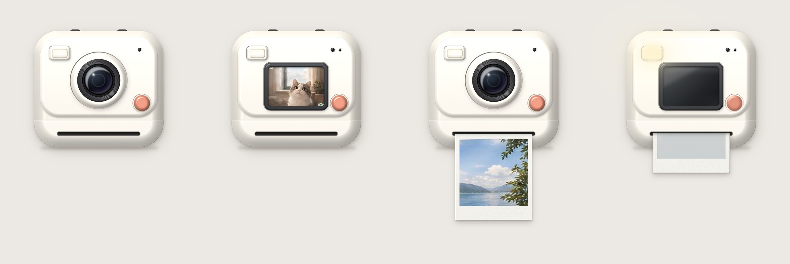

# Trinket Lab 🧸

**A collection of playful, reusable interactive objects for the web.**

[**Live demo →**](https://lilythking66-hub.github.io/Trinket-Lab/) · [Instant Photo](components/instant-photo/README.md) · [Instant Camera](components/instant-camera/README.md) · [Printer](components/printer/README.md) · [Skin contract](docs/SKIN_CONTRACT.md)

Trinket Lab is a home for small digital objects that feel like things: cameras that eject photos, printers that feed paper, books that open and turn, gacha machines, gift boxes, radios, and other tactile interactions.

The goal is not to build one giant UI framework. Each trinket should stay small, understandable, skinnable, and reusable across different products.

## Principles

- **Object first.** A trinket should feel like a coherent interactive object, not a pile of disconnected effects.
- **Reusable by default.** Product-specific logic stays outside the core component.
- **Triggers are adapters.** QR scanning, buttons, external events, NFC, or other triggers should call a component; they should not be baked into it.
- **Skin without rewrites.** Visual skins and content recipes should be replaceable without changing the interaction engine.
- **Shared motion, separate products.** Related trinkets can share engines while keeping distinct public components.
- **Stay lightweight.** Add tooling only when the repository actually needs it.

## First family: Instant Photo

The first Trinket Lab family is built around a shared photo engine.

~~~text
Trigger / Content Source
        │
        ├───────────────┐
        ▼               ▼
  Instant Photo    Instant Camera
(prepared image /   (live viewfinder,
 optional selfie)    camera capture)
        │               │
        └───────┬───────┘
                ▼
          Photo Engine
 flash → eject → develop → take/save
~~~

### components/photo-engine

Shared interaction mechanics: photo card, ejection motion, developing effect, film rendering, and output lifecycle.

### components/instant-photo

Takes an image or prepared photo recipe and performs the instant-photo interaction. It is print-only by default: camera code is not loaded unless the optional `selfie` attribute is present.

### components/instant-camera

Adds a live viewfinder and camera capture, then feeds the captured frame into the same Photo Engine. Camera resources are created on demand and fully released when the element leaves the page.

### components/camera-kit

Shared `getUserMedia` lifecycle and optional WebGL fisheye rendering. The Photo Engine does not depend on it.

### triggers/qr

An optional QR adapter. It can resolve a code into a photo recipe and call Instant Photo, but **Instant Photo does not know or care whether QR exists**.

## Neutral Skin V1

The first visual master is a neutral, minimal 2.5D instant camera with two interchangeable front panels: one for external-photo output and one for camera/selfie capture. The skin is a reference implementation, not part of the functional contract.

See [Instant Photo V1](docs/INSTANT_PHOTO_V1.md) for behavior and acceptance criteria, and [Skin Contract](docs/SKIN_CONTRACT.md) for the asset boundary.

## Repository shape

~~~text
Trinket-Lab/
├── components/
│   ├── photo-engine/
│   ├── camera-kit/
│   ├── instant-photo/
│   ├── instant-camera/
│   └── printer/
├── skins/
│   ├── neutral-camera-v1/
│   └── porcelain-printer-v1/
├── triggers/
│   └── qr/
├── demos/
│   ├── instant-photo-family/
│   └── printer/
└── docs/
    └── ARCHITECTURE.md
~~~

This is intentionally a lightweight foundation rather than a full monorepo setup. Build tooling can be introduced once multiple working trinkets genuinely need shared packaging/versioning.

## Future trinkets

Likely future residents include books and bookshelves, gacha machines, gift boxes, radios, photo booths, and other interactive props.

## Quick start

~~~sh
python3 -m http.server 8000
# open http://localhost:8000/demos/instant-photo-family/
~~~

~~~html

<instant-photo src="photo.jpg" caption="Good day :)"></instant-photo>
~~~

Add `selfie` only when you want camera access:

~~~html
<instant-photo selfie caption="Hi!"></instant-photo>
~~~

Plain ES modules and Web Components with no build step and no dependencies. The same code runs on desktop and mobile (touch, mouse and keyboard).

## Localization

Core UI defaults are English and can be overridden by the host before the component is ready:

~~~js
const camera = document.querySelector("instant-camera");
camera.labels = { shutter: "Snap", take: "Keep photo", openCamera: "Start camera" };
camera.messages = {
  denied: { text: "Camera access is blocked" },
  actions: { retry: "Try again", pick: "Choose an image" },
};
~~~

Product-specific copy belongs in the host app, not in the shared engine.

## Status

**Instant Photo Family V1 is implemented.** Photo Engine, Camera Kit, Instant Photo, Instant Camera, the optional QR trigger, replaceable skins and the public demo are working. The acceptance suite covers desktop Chrome, iPhone-sized emulation, camera lifecycle cleanup, lazy selfie loading and QR removal (`demos/instant-photo-family/tests/acceptance.cjs`). See [Instant Photo V1](docs/INSTANT_PHOTO_V1.md#v1-status).

## Printer

[Printer](components/printer/README.md) is the second build-free Trinket family: a platform-neutral rigid-sheet feed core plus the `<trinket-printer>` Web Component and a replaceable porcelain skin. Paper content stays in the host through a slot, so postcards, notes, receipts or product-specific layouts all reuse the same feed mechanics.

[Try the live Printer demo](https://lilythking66-hub.github.io/Trinket-Lab/demos/printer/), which deliberately feeds three different paper sizes through the same machine.
