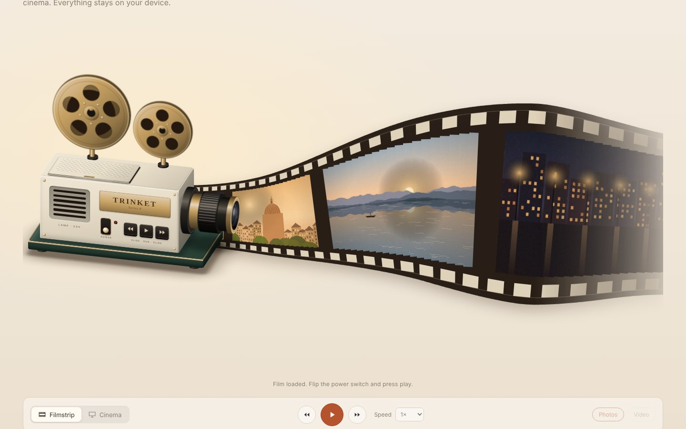

# Projector

A reusable 2.5D vintage projector: **add photos or an MP4 → you get a film can → open the projector's hatch and drop it in → run the photos past as a filmstrip, or dim the room and project them slide by slide. Video plays in the cinema.**

The projector is the reusable part. The photos, the video, persistence and any product logic stay in the host.

[Open the live demo →](https://lilythking66-hub.github.io/Trinket-Lab/demos/projector/)

## Use

~~~html

<trinket-projector mode="filmstrip" label="TRINKET"></trinket-projector>
~~~

Drop photos (or an MP4) on it, or click a reel to pick them: a film can appears on the table. Drag the can onto the projector (or click it): the hatch opens, the can drops into the bay, the hatch closes and the film is loaded. From JavaScript:

~~~js
const pj = document.querySelector("trinket-projector");

await pj.addRoll({ frames: input.files });  // a can on the table (Files, URLs or { src, title, … })
await pj.insertRoll();                      // open hatch → can into the bay → close → loaded
pj.play();                                  // switches the power on

// or skip the ceremony: loads straight away, the can is simply in the bay
await pj.loadPhotos(input.files);

pj.mode = "cinema";                          // same photo, now projected
await pj.loadVideo(mp4File, { show: true, autoplay: true });

pj.addEventListener("change", (e) => console.log("now showing", e.detail.index));
~~~

## Two modes, one reel

| | Filmstrip | Cinema |
|---|---|---|
| Layout | a large projector on the left; the film leaves its side and opens up in perspective along one long, low arc, then recedes and fades at the right | projector bottom-left, turned to face into the room (seen from behind and to the side) so the lens points at the screen; room dims, beam to the screen |
| Shows | photos only | photos (slideshow) or the video |
| Motion | continuous; drag, fling, scroll, tap a frame | one slide at a time with a mechanical change |
| Reels | turn exactly with the film | turn while running; follow the video |

Both modes read the same position, so switching keeps you on the same photo. The reel loops.

**Filmstrip.** The track never changes shape or wobbles; frames travel along it. Grab the film and drag it (it flings and then settles on a whole frame), scroll over it, or tap a frame to bring it to the gate. Arrow keys work on the focused strip. The film leaves the machine at the body's height and opens up as it comes forward; its tail narrows and fades instead of being cut off by the edge.

**Cinema.** The projected image takes the aspect of the photo or video. It has a soft vignette, fine moving grain, gate weave, lamp flicker and dust in the beam; the lens ring sets the focus. A slide change closes the shutter, swaps the picture and the image settles with a little jolt, and the reels give a turn.

## Loading film

The projector starts empty: no film on the reels, nothing on the strip. Content arrives as a **film can**:

1. `addRoll({ frames, clip, label })` (or files dropped / picked) puts a tin can on the table, labelled with the frame count or "MOTION PICTURE". A new can replaces one already waiting.
2. The viewer drags it onto the projector, or clicks it (Enter / Space when focused). `insertRoll()` does the same.
3. The hatch on top opens, the old can (if any) is lifted out, the new one arcs into the bay, the hatch closes, the reels fill with film and the strip unrolls out of the lens.

A can holds photos, a video, or both, and replaces what was loaded. The hatch can also be opened and closed by clicking it, to look at the can inside. Set `insert="auto"` to load dropped/picked files without waiting for the viewer.

## On the machine

- **Power switch**: lamp warms up, grille glows, fan hums.
- **◀ ▶ keys**: previous / next photo (in video: −/+10 s). **Middle key**: play / pause.
- **Lens ring**: drag it, scroll over it, or use the arrow keys when focused. 0 is sharp; the image blurs either way.
- **Reels**: click to pick photos or a video; they arrive as a can (cancel the `pick` event to show your own picker).
- **Hatch**: on top, over the film bay. Click to open or close it.

`play()` switches the power on if needed. Sounds (switch, keys, slide change, reel mount, sprockets, motor clatter, fan) are synthesized. There are no audio or image assets.

## Local files

`reel-maker.js` works without the projector:

~~~js
import { createFrames, createClip, sortFiles, canPlayH264 } from "./components/projector/projector-element.js";

const frames = await createFrames(input.files);  // [{ id, src, thumb, width, height, aspect, title, file }]
const { frames, clip } = await sortFiles(dataTransfer.files); // photos + the first video
canPlayH264();                                    // "probably" | "maybe" | ""
~~~

Each photo becomes an object URL plus a ~640 px thumbnail for the film strip. Order is kept. HEIC is skipped (browsers can't display it). Nothing is uploaded. Call `releaseFrame(frame)` / `releaseClip(clip)` when you throw one away (the projector does this for reels it replaces).

Video: H.264 MP4 is the target; anything the browser can play works (WebM, MOV in Safari…). There is no transcoding. If the browser can't decode it the projector fires `error` (`reason: "video"`) and `blocked` (`reason: "codec"`) and goes back to the photos.

### Frame shape

| Field | Meaning |
|---|---|
| `src` | full image URL (shown in Cinema) |
| `thumb` | smaller URL for the film strip (defaults to `src`) |
| `title` | text (file name without extension) |
| `width`, `height`, `aspect` | filled in when loaded |
| `file` | the original `File`, if any (useful for persistence) |
| anything else | passed through untouched |

## Public API

### Attributes

| Attribute | Meaning |
|---|---|
| `mode` | `filmstrip` (default) · `cinema` |
| `theme` | `green` · `walnut`; omit for ivory |
| `label`, `model` | name plate (default `TRINKET` / `Series 8`) |
| `speed` | 0.1–6, default 1: film speed and slideshow pace |
| `interval` | seconds per slide in Cinema at speed 1 (default 4) |
| `grain` | film grain 0–1 (default 0.5) |
| `volume` | 0–1, sounds and video |
| `muted` | silence everything |
| `sfx="off"` | no mechanical sounds |
| `autoplay` | `loadPhotos()` starts playing |
| `drop="off"` | don't accept dropped files |
| `insert="auto"` | dropped / picked files load straight away instead of waiting as a can |
| `state` | reflected: `empty · off · paused · playing` |

### Properties & methods

`mode`, `source` (`photos` · `video`, what Cinema shows), `power`, `playing`, `index`, `frame`, `frames`, `clip`, `focus` (−1…1, 0 sharp), `speed`, `interval`, `state`, `labels`, `videoElement`

`roll` (the can waiting on the table), `loadedRoll`, `lidOpen`

`whenReady()`, `addRoll({ frames, clip, label })`, `insertRoll(roll?)`, `openLid()`, `closeLid()`, `loadPhotos(list, { append, autoplay })`, `clearPhotos()`, `loadVideo(fileOrUrl, { show, autoplay })`, `clearVideo()`, `importFiles(files)`, `openPicker("photos" | "video")`, `play()`, `pause()`, `toggle()`, `next()`, `prev()`, `goTo(index, { instant })`

### Events

`ready`, `roll` (a can is waiting), `insert` (a can went in and its film is loaded), `lid` (`open`), `load` (`frames`), `video` (`clip`), `change` (`index`, `frame`), `select` (a frame was tapped), `modechange`, `sourcechange`, `power`, `play`, `pause`, `statechange`, `focuschange`, `timeupdate` / `durationchange` / `seek` (video), `pick` (a reel was clicked; cancelable), `import` (files dropped or picked; cancelable, `detail.frames`, `detail.clip`), `blocked` (`reason: empty | no-roll | no-video | not-image | not-video | not-media | codec | autoplay`), `error`.

### Styling hooks

Size: the element is `width: 100%` with `aspect-ratio: 16 / 9`; override with `--trinket-projector-aspect` or an explicit height. **The projector is designed for wide (desktop) screens.** On a narrow screen it keeps the same layout, scaled down; there is no portrait layout.

Colours: `--trinket-projector-body`, `--trinket-projector-grain` (wood grain, 0 = painted), `--trinket-projector-base`, `--trinket-projector-metal`, `--trinket-projector-accent`, `--trinket-projector-print`, `--trinket-projector-light` (lamp), `--trinket-projector-room` (Cinema darkness), `--trinket-projector-film`.

Parts: `stage`, `room`, `screen`, `machine`, `film`, `nameplate`, `drop`.

The component only darkens its own stage in Cinema. To dim the whole page too, react to `modechange` or style `trinket-projector[mode="cinema"]` with `:has()`.

### Localization

~~~js
pj.labels = {
  power: "电源", play: "播放 / 暂停", prev: "上一张", next: "下一张",
  focus: "调焦环", reel: "装入照片", film: "胶片：拖动浏览", screen: "投影幕",
  drop: "把照片或 MP4 拖到这里", photo: "第 {i} / {n} 张",
  can: "胶片盒：拖进放映机，或点一下装入", lid: "片舱盖",
};
~~~

## Structure

~~~text
projector-core.js     power, lamp, film offset physics, slides, reels, focus (no DOM)
film-path.js          the fixed wave track: spline, arc length, offsets (no DOM)
reel-maker.js         files → frames (thumbnails) and clips, type checks
projector-art.js      orthographic camera, lens / reel / cylinder drawing
sound.js              synthesized clatter, fan and mechanical cues
style.js              shadow-DOM styles + finishes
projector-element.js  <trinket-projector>: layout, film, cinema, input, choreography
~~~

Same drawing approach as the Turntable (with two cameras: lens-right for Filmstrip, from behind for Cinema; the machine crossfades between them mid-transition): an orthographic camera computed in JavaScript, flat faces as 2D affine CSS matrices, cylinders as SVG silhouettes. No CSS 3D, so layering is DOM order, hit-testing is exact and Safari behaves. A raster skin could replace `projector-art.js` as long as it keeps `MODEL` and `LENS_EXIT`.

## Notes

- Works with mouse, touch and keyboard. Honours `prefers-reduced-motion` (no weave, still grain, instant mode change).
- Browsers only allow sound after a user gesture. If a video can only start muted, `blocked` with `reason: "autoplay"` tells you.
- The animation loop sleeps when nothing moves; in a lit Cinema it keeps running for the grain and dust.
- The film is drawn on a canvas: each photo is cut into thin slices that follow the track, so pictures bend with the film instead of floating on it. Only the frames on screen are drawn, so large reels are fine.
