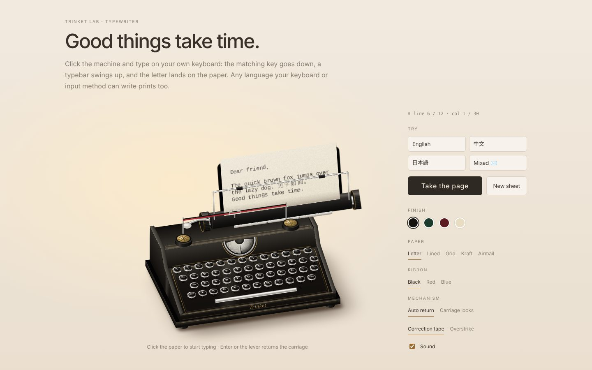

# Typewriter

A reusable 2.5D vintage typewriter: **type on your own keyboard → the matching key goes down → a typebar swings up → the letter lands on the paper and the carriage moves on.**

The machine is the reusable part. What the page is for (a letter, a note, a gift card), where the text goes afterwards and any product rules stay in the host.

[Open the live demo →](https://lilythking66-hub.github.io/Trinket-Lab/demos/typewriter/)

## Use

~~~html

<trinket-typewriter label="Trinket" paper="plain"></trinket-typewriter>
~~~

Click the paper (or call `focus()`) and type. From JavaScript:

~~~js
const tw = document.querySelector("trinket-typewriter");

await tw.type("Dear friend,\nGood things take time.", { cps: 14 }); // animated, with sound
tw.print("Already on the page.\n");                                  // instant, silent
tw.addEventListener("change", (e) => console.log(e.detail.text));

const page = await tw.eject();   // { text, lines, glyphs, columns, rows }
await tw.newSheet();
~~~

## How it behaves

- **Keys follow physical positions.** The cap that moves is picked by `KeyboardEvent.code`, so on AZERTY, Dvorak or with a Chinese / Japanese / Korean input method the key under your finger still goes down. Clicking a cap types its own character (Shift and LOCK work).
- **Every strike is a small mechanism:** key down, typebar flight (~50 ms), impact (ink appears, ribbon vibrator lifts), escapement (the carriage steps one cell with a little settle), typebar return.
- **Carriage return** by Enter, the lever, or automatically at the margin (`line-end="wrap"`, default). With `line-end="lock"` the carriage locks at the margin like a real machine. The bell rings five cells before the end.
- **Backspace** is a correction tape by default (the character lifts off; at column 0 the paper rolls back a line). `backspace="move"` only steps the carriage back, so the next strike overprints.
- **Ink is imperfect on purpose:** each strike gets its own tiny offset, tilt, density and uneven impression, stored with the glyph so re-renders look the same.
- The platen knobs feed a line; the shift keys drop the typebar segment; the sheet emerges from the platen line by line.
- All sounds (keys, slug, escapement, bell, return slide and slam, ratchet, paper) are synthesized. There are no audio assets.

## Languages

The paper is real DOM text, so anything the browser can render prints: Latin with accents, Cyrillic, Greek, CJK, kana, Hangul, Thai, Devanagari, emoji.

| | |
|---|---|
| Input methods | IME composition shows as a pencil "ghost" at the print point, then the committed text is struck character by character |
| Character units | grapheme clusters (`Intl.Segmenter`): `é`, `👍🏽`, `क्षि` are one strike each |
| Width | East-Asian wide characters and emoji take two cells, like a CJK terminal; full-width space `　` is one keystroke filling two cells (one backspace removes it, `text` keeps it as `　`) |
| Fonts | `--trinket-typewriter-font`: typewriter faces first, then Songti / Mincho / Noto Serif CJK fallbacks |
| Key legends | `layout` property (see below), e.g. AZERTY or Zhuyin legends; only the caps change |
| Right-to-left | **not in V1.** Hebrew/Arabic characters print, but one per cell left-to-right and without Arabic joining. A `direction="rtl"` mode (carriage moving the other way, a line drawn as one shaped run) is the planned extension |

## Public API

### Attributes

| Attribute | Meaning |
|---|---|
| `theme` | `green` · `burgundy` · `cream`; omit for classic black |
| `paper` | `plain` (default) · `lined` · `grid` · `kraft` · `airmail` |
| `ink` | `black` (default) · `red` · `blue` · `brown` · `green` or any CSS colour |
| `columns` | characters per line (default 30, 8–80) |
| `rows` | lines per sheet (default 12) |
| `label` | brand on the front plate (default `Trinket`) |
| `line-end` | `wrap` (default, automatic return) · `lock` |
| `backspace` | `erase` (default) · `move` |
| `page-end` | omit to stop at the last line (fires `pagefull` with the `dropped` text); `new` to roll the sheet out, feed a new one and carry on with everything still being typed (works for `print()` too) |
| `readonly` | plays back `type()` / `print()` but ignores the user's keys |
| `keyboard="off"` | clicking does not focus the hidden input (on-screen caps still work) |
| `autofocus` | focus on connect |
| `sfx="off"`, `muted`, `volume` | sound |

### Properties & methods

`text`, `lines`, `line`, `column`, `columns`, `rows`, `hasPaper`, `shift`, `busy`, `labels`, `layout`

`whenReady()`, `focus()`, `blur()`, `type(text, { cps, humanize, signal })`, `print(text)`, `press(code)`, `space()`, `tab()`, `backspace()`, `carriageReturn()`, `lineFeed(n)`, `eject()`, `newSheet()`, `clear()`

`type()` waits for each strike and resolves when the last one is on the paper; pass an `AbortSignal` to stop it.

### Events

`ready`, `type` (`{ char, line, column }`, at the moment of impact), `space`, `backspace` (`{ erased }`), `return` (`{ auto }`), `linefeed`, `bell`, `lineend`, `pagefull` (`{ dropped }`), `eject` (`{ page }`), `sheet`, `change` (`{ text }`), `focus`, `blur`.

### Styling hooks

CSS custom properties: `--trinket-typewriter-body`, `--trinket-typewriter-trim` (gold pinstripes and brass), `--trinket-typewriter-metal`, `--trinket-typewriter-key`, `--trinket-typewriter-legend`, `--trinket-typewriter-ink`, `--trinket-typewriter-ribbon`, `--trinket-typewriter-paper`, `--trinket-typewriter-shadow`, `--trinket-typewriter-font`, `--trinket-typewriter-width`.

Parts: `stage`, `sheet`.

### Key layout

~~~js
import { QWERTY } from "./components/typewriter/typewriter-element.js";
import { k, fn } from "./components/typewriter/keyboard-layout.js";

tw.layout = {
  offsets: [0, 0.3, 0.55, 0.05],
  rows: [
    [k("Digit1", "&", "1"), /* … */ fn("Backspace", "back", "←")],
    [fn("Tab", "tab", "TAB"), k("KeyQ", "a"), k("KeyW", "z"), /* AZERTY legends on QWERTY positions */],
    // …
  ],
};
~~~

Each key is `{ code, kind: "char" | "shift" | "lock" | "tab" | "back", char, shift, legend }`. `code` is the physical key, `legend` what is printed on the cap.

### Localization

~~~js
tw.labels = { machine: "打字机：直接输入即可打印", lever: "回车杆", knob: "滚轴旋钮：进一行", paper: "纸张", space: "空格键" };
~~~

## Structure

~~~text
typewriter-core.js     sheet grid, carriage, line feed, bell, backspace, wide cells, graphemes (no DOM)
keyboard-layout.js     cap layouts: physical code → legend / character; char → cap
typewriter-art.js      orthographic camera, body, carriage, ribbon, typebars, key geometry
sound.js               synthesized mechanics
style.js               shadow-DOM styles, finishes, paper styles
typewriter-element.js  <trinket-typewriter>: input & IME, stroke queue, choreography
~~~

The machine is drawn with an orthographic camera computed in JavaScript (the same approach as Turntable): flat faces are 2D affine CSS matrices, cylinders are SVG silhouettes, and the carriage, which only ever moves along x, is a single translated layer. There is no CSS 3D.

## Notes

- Works with mouse, touch and keyboard. On phones, tapping the paper opens the on-screen keyboard; tapping caps types without it. Android keyboards commit Latin text word by word, so it lands when you press space.
- Taking the element off the page stops it completely: queued keystrokes are dropped, running `type()` calls return, pending `eject()` / `newSheet()` promises settle, and no frame loop or sound keeps running. Moving it (remove + append in the same task) does not interrupt typing.
- Escape leaves the typewriter (blurs the input). Shortcuts with Ctrl / ⌘ are left to the browser.
- Browsers only play sound after a user gesture; the first click or key unlocks it.
- Honours `prefers-reduced-motion` (no ink flash).
